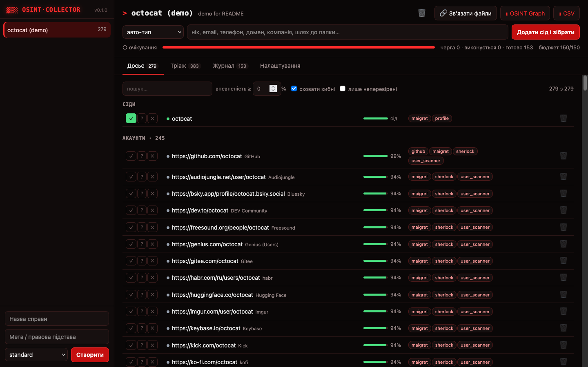
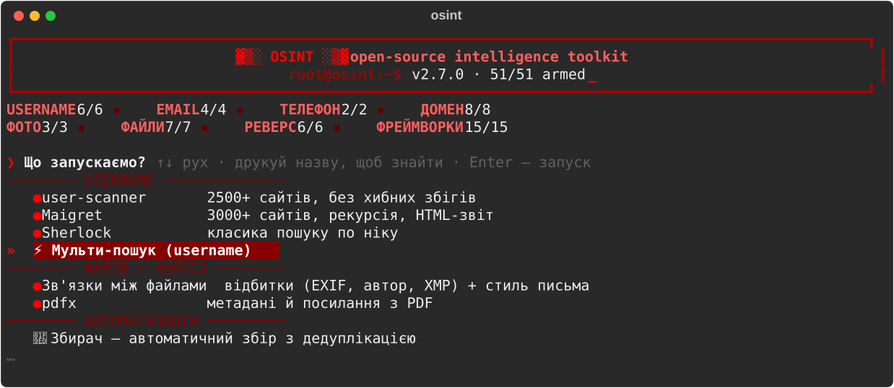

<div align="center">



**50+ open-source OSINT tools behind one command, and a collector that turns their noise into one clean, evidence-backed case.**

[](#-install)
[](#-install)
[](requirements.txt)
[](tests)
[](LICENSE)

[**Install**](#-install) · [**Collector**](#-collector) · [**Tools**](#-tools) · [**Self-audit**](#-self-audit) · [**Українською**](#-українською)

</div>

---

## ▓▒░ What it is

<table>
<tr>
<td width="33%" valign="top">

### 🖥️ Launcher
One `osint` command, a red terminal menu, 50+ tools grouped by target. Type a nick, email, phone, domain or file and run one tool, or every matching tool in a row.

</td>
<td width="33%" valign="top">

### 🧭 Collector
Runs the tools for you, then **merges, scores and filters** what they find: one entity per real thing, confidence from independent sources, fake hits thrown out, evidence for every claim.

</td>
<td width="33%" valign="top">

### 🔒 Private by design
Everything runs on your machine, the web UI listens on `127.0.0.1` only. No check that would send the target a password-reset email. No leaked-password databases.

</td>
</tr>
</table>

<div align="center">

<sub>Collector on GitHub's demo account <code>octocat</code>: every account shows which tools confirmed it and how sure the result is.</sub>
</div>

## ⚡ Install

**macOS** (needs [Homebrew](https://brew.sh)):

```bash
git clone https://github.com/radmorex/osint-launcher ~/tools/osint-launcher
cd ~/tools/osint-launcher && ./install-macos.sh && exec zsh
```

**Windows** (PowerShell, needs `winget`):

```powershell
iwr https://github.com/radmorex/osint-launcher/archive/refs/heads/main.zip -OutFile $env:TEMP\osint.zip
Expand-Archive $env:TEMP\osint.zip $env:TEMP -Force
powershell -ExecutionPolicy Bypass -File $env:TEMP\osint-launcher-main\install-windows.ps1
```

Re-running is safe: finished steps are skipped, failures are listed at the end.

| Extra: macOS | Extra: Windows | Adds |
|---|---|---|
| `--with-reverse` | `-WithReverse` | Ghidra and the MobSF image (jadx and apktool are always installed) |
| `--with-frameworks` | `-WithFrameworks` | the all-in-one OSINT frameworks |
| `--with-docker` | `-WithDocker` | Docker ([Colima](https://github.com/abiosoft/colima) on macOS, Docker Desktop on Windows); MobSF, Scrummage, Legion, osint-analyser, IntellyWeave need it |
| `--with-sherloq` | `-WithSherloq` | image-forensics GUI (~1.5 GB) |

Example, everything on Windows: `... install-windows.ps1 -WithReverse -WithFrameworks -WithDocker`.
On the first Docker Desktop install Windows may ask for a reboot: reboot, start Docker Desktop once, run the installer again with the same options.

> The Windows installer has not been run on a real machine yet. If a step fails, please [open an issue](https://github.com/radmorex/osint-launcher/issues) with its **Failed steps** list.

## 🕹️ Use

```bash
osint                    # the menu
osint --check            # full table of what is installed
osint collect            # collector web UI on http://127.0.0.1:8765
osint collect run night_owl you@example.com --out case.osint.json
osint collect link ~/Documents/folder     # link files by metadata and writing style
```

<div align="center">

</div>

## 🧭 Collector

Single tools are noisy: the same account three times, sites that "find" any nick, nothing linking one finding to the next. The collector fixes that.

| | How |
|---|---|
| **One entity per real thing** | every value is normalised first: Gmail dots and `+tags`, phones to E.164, IDN to punycode, URLs without `www.` and tracking. `github.com/Owl/` and `https://github.com/owl` are one account |
| **Confidence from corroboration** | `1 − Π(1 − c)` over *distinct* modules: two independent sources beat one tool repeating itself |
| **Fake hits thrown out** | each Maigret / Sherlock run also checks a random canary nick; sites that "find" it are dropped and remembered for 30 days |
| **Found accounts get opened** | each profile is read (socid-extractor): name, country, created date, links, other nicks |
| **Hidden links surface** | Gravatar e-mail hashes in avatars join a profile to its e-mail; camera serials, document authors and XMP IDs join files |
| **Controlled pivots** | only confident, in-scope findings within depth and budget expand by themselves; the rest wait in **Тріаж** with reason and cost |
| **You decide** | ✓ ? ✗ on every entity; a false lead is never expanded again and stays out of exports; 🗑 removes it from the case |
| **Evidence** | every claim keeps the tool, the time and the SHA-256 of the raw response |

Export to [OSINT Graph](https://github.com/radmorex/osint-graph) (`.osint.json`) or CSV.

<details>
<summary><b>Profiles, companies, files, local modules</b></summary>

**Profiles.** `quick`: built-in public sources only (DNS, crt.sh, RDAP, RIPEstat, Wayback, GitHub, Gravatar). `standard`: + Maigret, Sherlock, user-scanner, profile reading, Ignorant, Subfinder, PhoneInfoga, company modules. `deep`: + theHarvester, Holehe (outdated: most of its checks no longer work), Maigret on 1500 sites. `selfaudit`: `standard` + your local modules.

**Companies.** Seed a company name (CrossLinked, no login) or its LinkedIn / XING page (LinkedInDumper / XingDumper, cookie in `LINKEDIN_LI_AT` / `XING_LOGIN_COOKIE`; both sites ban scraping, use a spare account). With an e-mail format such as `{first}.{last}@firma.ua` (Cyrillic transliterated) likely addresses are added at 30% confidence and wait in triage.

**Files.** Seed a file or a folder. Nothing leaves the machine. Metadata fingerprints (ExifTool), writing style (character trigrams, frequent words, typing habits; Cosine Delta with 3+ texts; a lead, not proof), near-duplicate photos (difference hash). Text from txt, md, html, docx, odt, rtf and PDF.

**Local modules.** `*.py` in `collector/local/` (gitignored) or `~/.osint-collector/modules/` are loaded at start-up and never committed.

**Keys** (all optional): `GITHUB_TOKEN`, `GRAVATAR_API_KEY`.
</details>

## 🪞 Self-audit

Run the collector on **your own** nick, e-mail and phone (`--profile selfaudit`) to see what a stranger can link together: which services know your e-mail, where your nicks live, what your profiles reveal, which accounts give away your e-mail through an avatar hash. Then tighten privacy settings where it matters.

## 🧰 Tools

<details>
<summary><b>Full list (50+), by target</b></summary>

| Target | Tools |
|---|---|
| 👤 Username | [user-scanner](https://github.com/kaifcodec/user-scanner), [Maigret](https://github.com/soxoj/maigret), [Sherlock](https://github.com/sherlock-project/sherlock), [Snoop](https://github.com/snooppr/snoop), [Social Analyzer](https://github.com/qeeqbox/social-analyzer), [Nexfil](https://github.com/thewhiteh4t/nexfil) |
| ✉️ Email | [user-scanner](https://github.com/kaifcodec/user-scanner), [GHunt](https://github.com/mxrch/GHunt), [Mosint](https://github.com/alpkeskin/mosint), [Holehe](https://github.com/megadose/holehe) *(outdated)* |
| 📞 Phone | [Ignorant](https://github.com/megadose/ignorant), [PhoneInfoga](https://github.com/sundowndev/phoneinfoga) |
| 🌐 Domain | [Subfinder](https://github.com/projectdiscovery/subfinder), [Amass](https://github.com/owasp-amass/amass), [theHarvester](https://github.com/laramies/theHarvester), [waybackurls](https://github.com/tomnomnom/waybackurls) |
| 🏢 Company | [CrossLinked](https://github.com/m8sec/CrossLinked), [LinkedInDumper](https://github.com/l4rm4nd/LinkedInDumper), [XingDumper](https://github.com/l4rm4nd/XingDumper), [the-endorser](https://github.com/eth0izzle/the-endorser) |
| 🪪 Profiles | [socid-extractor](https://github.com/soxoj/socid-extractor) (~270 sites) |
| 🖼️ Media | [ExifTool](https://exiftool.org), [Sherloq](https://github.com/GuidoBartoli/sherloq), [Instaloader](https://github.com/instaloader/instaloader) |
| 📄 Files | built-in file linking, [pdfx](https://github.com/metachris/pdfx), [oletools](https://github.com/decalage2/oletools), [mutagen](https://github.com/quodlibet/mutagen), [c2patool](https://github.com/contentauth/c2pa-rs), [iocextract](https://github.com/InQuest/iocextract) |
| 🧩 Reverse | [Ghidra](https://github.com/NationalSecurityAgency/ghidra), [jadx](https://github.com/skylot/jadx), [apktool](https://github.com/iBotPeaches/Apktool), [APKLeaks](https://github.com/dwisiswant0/apkleaks), [xortool](https://github.com/hellman/xortool), [MobSF](https://github.com/MobSF/Mobile-Security-Framework-MobSF) |
| 🧠 Frameworks | [BBOT](https://github.com/blacklanternsecurity/bbot), [SpiderFoot](https://github.com/smicallef/spiderfoot), [Osintgraph](https://github.com/XD-MHLOO/Osintgraph), [OpenOSINT](https://github.com/OpenOSINT/OpenOSINT), [Maryam](https://github.com/saeeddhqan/Maryam), [ReconSpider](https://github.com/bhavsec/reconspider), [TensSens](https://github.com/thenurhabib/tenssens), [Ashok](https://github.com/powerexploit/Ashok), [OSINTEye](https://github.com/ritchiemwewa/osinteye), [X-osint](https://github.com/TermuxHackz/X-osint), [Scrummage](https://github.com/matamorphosis/Scrummage), [osint-analyser](https://github.com/joestanding/osint-analyser), [IntellyWeave](https://github.com/vericle/intellyweave), [Legion](https://github.com/carlospolop/legion); Linux only: [discover](https://github.com/leebaird/discover), [Pip-Intel](https://github.com/emrekybs/Pip-Intel) |

**Left out on purpose:** tools that pull leaked passwords or breach records about people (h8mail, dehashed, DaProfiler, Phone OSINT Framework, WEREWIKS) and ReconXplorer (Discord token checking, webhook spam).
</details>

<details>
<summary><b>Where things go</b></summary>

| | macOS | Windows |
|---|---|---|
| Launcher | `~/tools/osint-launcher` | `~\tools\osint-launcher` |
| Python CLIs | `pipx` → `~/.local/bin` | `pipx` → `~\.local\bin` |
| Go CLIs | `~/go/bin` | `~\go\bin` |
| Git-based tools | `~/tools/<name>` with their own `.venv` | same |
| Reports and cases | `~/osint-reports` | `~\osint-reports` |

`OSINT_TOOLS_DIR`, `OSINT_REPORTS_DIR` and `OSINT_SPIDERFOOT_ADDR` override the defaults.
</details>

<details>
<summary><b>Troubleshooting</b></summary>

- **A tool shows ○ in `osint --check`.** Re-run the installer; it installs only what is missing and lists failures. Docker tools need `--with-docker` (Windows: `-WithDocker`).
- **GHunt** needs a one-time Google login: menu → *🔑 GHunt — вхід у Google*.
- **Osintgraph** needs `osintgraph setup` (Instagram account, Neo4j, optional Gemini key): menu → *⚙ Osintgraph — налаштування*.
- **BBOT 3.x fails to build on macOS:** the installer pins `bbot<3`.
- **Old repos with broken requirements** (missing packages, stdlib names, Python 2 leftovers): the installer cleans requirements, retries without version pins and installs what the code imports.
- **Windows: broken box characters:** use Windows Terminal.
</details>

## ⚖️ Legal & ethics

Public sources only. Use it on yourself, with consent, or for lawful investigations, research, journalism and CTFs. You are responsible for the laws of your jurisdiction and each site's terms. Don't stalk, harass or dox people.

All the heavy lifting is done by the tools above; each keeps its own license. Launcher and collector: [MIT](LICENSE) © 2026 radmorex.

---

## 🇺🇦 Українською

**osint-launcher** — одна команда `osint` відкриває червоне меню з 50+ OSINT-інструментами. **Збирач** (`osint collect`) запускає їх сам і зводить знахідки в одну чисту справу: дублікати зливаються, впевненість рахується за кількістю незалежних джерел, хибні збіги відсіюються канаркою, знайдені профілі відкриваються, а кожне твердження має SHA-256 доказу. Профіль `selfaudit` показує, що про **вас** можна знайти й зв'язати.

```bash
git clone https://github.com/radmorex/osint-launcher ~/tools/osint-launcher
cd ~/tools/osint-launcher && ./install-macos.sh && exec zsh
```

Windows: команди PowerShell у розділі [Install](#-install). Лише для законних цілей.
