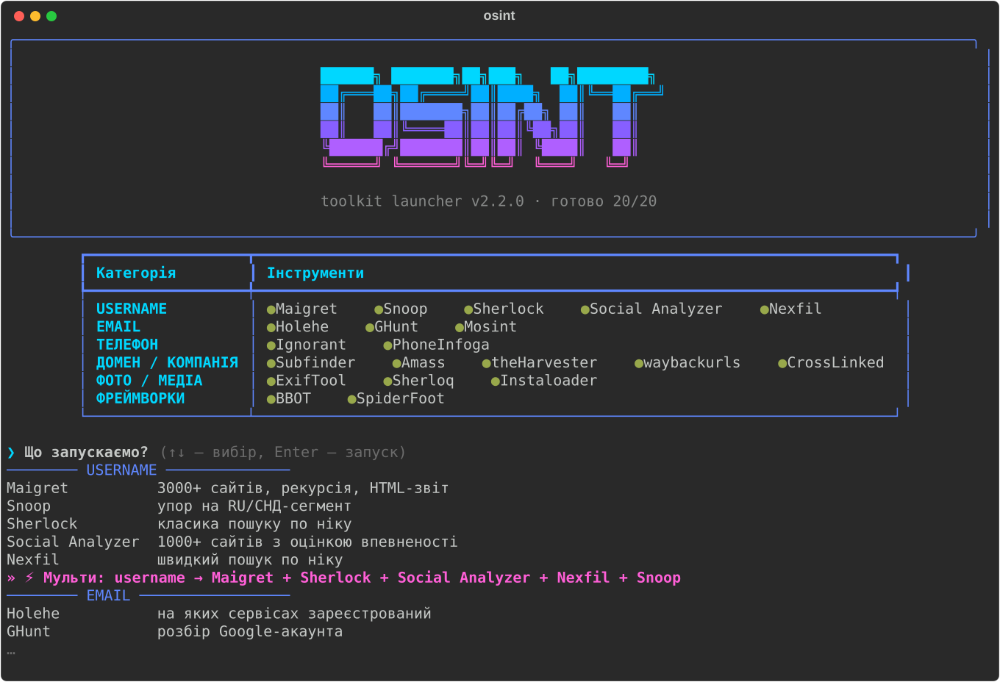
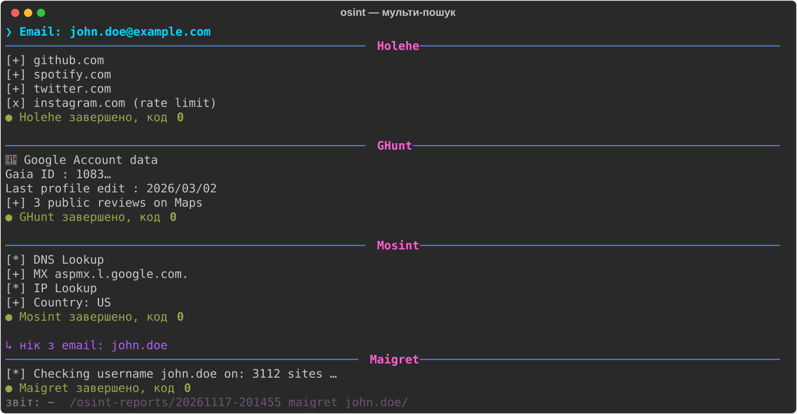

<div align="center">

# 🛰️ osint-launcher

**One command. Twenty open-source OSINT tools. One clean terminal menu.**

Pick a tool with the arrow keys, type a target, get results, or run a **multi-search** that pushes a single username, email, phone number or domain through every matching tool in one go.

[](#-macos)
[](#-windows)
[](requirements.txt)
[](#-tools)
[](LICENSE)



</div>

---

## ✨ Features

- **Interactive TUI**: arrow-key menu grouped by target type, live install status for every tool, input validation before anything runs.
- **Multi-search**: one target, every relevant tool, run one after another:

  | Target | Runs |
  |---|---|
  | 👤 username | Maigret → Sherlock → Social Analyzer → Nexfil → Snoop |
  | ✉️ email | Holehe → GHunt → Mosint → *the part before `@`* through Maigret + Sherlock |
  | 📞 phone | Ignorant → PhoneInfoga |
  | 🌐 domain | Subfinder → theHarvester → waybackurls → Amass |

- **Reports saved automatically** to `~/osint-reports/<timestamp>_<tool>_<target>/`.
- **No registration, no API keys**: everything works out of the box. Keys only unlock extra Mosint sources.
- **One-shot installers** for macOS and Windows. Safe to re-run: anything already installed is skipped.
- **Missing tools never break the menu**: they are greyed out, and multi-search skips them.

<div align="center">

<br><sub>Email multi-search (illustrative output)</sub>
</div>

## 🧰 Tools

| Category | Tool | What it does | macOS | Windows |
|---|---|---|:-:|:-:|
| 👤 Username | [Maigret](https://github.com/soxoj/maigret) | 3000+ sites, recursive search, HTML report | ✅ | ✅ |
| | [Snoop](https://github.com/snooppr/snoop) | Strong RU/CIS coverage | ✅ | ✅ |
| | [Sherlock](https://github.com/sherlock-project/sherlock) | The classic username hunter | ✅ | ✅ |
| | [Social Analyzer](https://github.com/qeeqbox/social-analyzer) | 1000+ sites with confidence scoring | ✅ | ✅ |
| | [Nexfil](https://github.com/thewhiteh4t/nexfil) | Fast username lookup | ✅ | ✅ |
| ✉️ Email | [Holehe](https://github.com/megadose/holehe) | Which services an email is registered on | ✅ | ✅ |
| | [GHunt](https://github.com/mxrch/GHunt) | Google account investigation | ✅ | ✅ |
| | [Mosint](https://github.com/alpkeskin/mosint) | Breaches, DNS, IP info for an email | ✅ | ✅ |
| 📞 Phone | [Ignorant](https://github.com/megadose/ignorant) | Which services a phone number is registered on | ✅ | ✅ |
| | [PhoneInfoga](https://github.com/sundowndev/phoneinfoga) | Country, carrier, line type, search dorks | ✅ | ✅ |
| 🌐 Domain / company | [Subfinder](https://github.com/projectdiscovery/subfinder) | Passive subdomain discovery | ✅ | ✅ |
| | [Amass](https://github.com/owasp-amass/amass) | Deep subdomain enumeration (OWASP) | ✅ | ✅ |
| | [theHarvester](https://github.com/laramies/theHarvester) | Emails, hosts and subdomains from public sources | ✅ | ✅ |
| | [waybackurls](https://github.com/tomnomnom/waybackurls) | Every URL of a domain in the Wayback Machine | ✅ | ✅ |
| | [CrossLinked](https://github.com/m8sec/CrossLinked) | Employee names from LinkedIn via search engines → likely emails | ✅ | ✅ |
| 🖼️ Media | [ExifTool](https://exiftool.org) | Metadata: GPS, camera, timestamps, software | ✅ | ✅ |
| | [Sherloq](https://github.com/GuidoBartoli/sherloq) | Image forensics GUI *(optional, ~1.5 GB)* | ✅ | ✅ |
| | [Instaloader](https://github.com/instaloader/instaloader) | Public Instagram profiles, no login | ✅ | ✅ |
| 🧠 Frameworks | [BBOT](https://github.com/blacklanternsecurity/bbot) | Recursive recon: subdomains + emails | ✅ | ⚠️ WSL only |
| | [SpiderFoot](https://github.com/smicallef/spiderfoot) | 200+ modules, web UI with a relationship graph | ✅ | ✅ |

## 🚀 Install

### 🍎 macOS

Requires [Homebrew](https://brew.sh).

```bash
git clone https://github.com/radmorex/osint-launcher ~/tools/osint-launcher
cd ~/tools/osint-launcher && ./install-macos.sh
exec zsh   # reload the shell so the `osint` alias exists
```

Add `--with-sherloq` to also install the image-forensics GUI.

### 🪟 Windows

Requires Windows 10/11 with `winget` (pre-installed on Windows 11). Run in **PowerShell**:

```powershell
iwr https://github.com/radmorex/osint-launcher/archive/refs/heads/main.zip -OutFile $env:TEMP\osint.zip
Expand-Archive $env:TEMP\osint.zip $env:TEMP -Force
powershell -ExecutionPolicy Bypass -File $env:TEMP\osint-launcher-main\install-windows.ps1
```

Then open a **new** terminal (Windows Terminal recommended) and run `osint`. Add `-WithSherloq` to the last command for the image-forensics GUI.

> The Windows installer is new. If a step fails, it prints a **Failed steps** list at the end: please [open an issue](https://github.com/radmorex/osint-launcher/issues) with that output.
>
> The installer doesn't touch your PowerShell profile or execution policy. `osint` is a small `osint.cmd` in `~\tools\bin`, which the installer adds to your user `PATH`.

### What goes where

| | macOS | Windows |
|---|---|---|
| Launcher | `~/tools/osint-launcher` | `~\tools\osint-launcher` |
| Python CLIs | `pipx` → `~/.local/bin` | `pipx` → `~\.local\bin` |
| Go CLIs | `~/go/bin` | `~\go\bin` |
| Binaries | Homebrew | GitHub releases → `~\tools\bin` |
| Snoop / SpiderFoot / Sherloq | `~/tools/<name>` with their own `.venv` | same |
| Reports | `~/osint-reports` | `~\osint-reports` |

## 🕹️ Usage

```bash
osint            # interactive menu
osint --check    # show which tools are installed and exit
osint --version
```

- `↑` `↓` to move, `Enter` to run, `Ctrl+C` to stop the current tool or go back.
- **ExifTool**: drag a file into the terminal window to paste its path.
- **SpiderFoot** starts its web UI on `127.0.0.1:5001` and opens your browser. Press `Ctrl+C` to stop it.
- **GHunt** needs a one-time Google login: menu → *GHunt: увійти в Google*.

### Configuration

| Variable | Default | Purpose |
|---|---|---|
| `OSINT_TOOLS_DIR` | `~/tools` | Where Snoop / SpiderFoot / Sherloq are cloned |
| `OSINT_REPORTS_DIR` | `~/osint-reports` | Where reports and captured output go |
| `OSINT_SPIDERFOOT_ADDR` | `127.0.0.1:5001` | SpiderFoot web UI address |

**Mosint API keys (optional):** the installer creates `~/.mosint.yaml` with placeholder keys. Put real keys there (Hunter, IntelX, HIBP, BreachDirectory, EmailRep) to unlock more sources. DNS and IP lookups work without keys.

## 🩺 Troubleshooting

<details>
<summary><b>A tool shows ○ in <code>osint --check</code></b></summary>

Re-run the installer. It only installs what's missing and prints a **Failed steps** list at the end. The launcher also looks in `~/.local/bin`, `~/go/bin` and `~/tools/bin` even when they aren't in your `PATH`.
</details>

<details>
<summary><b>BBOT 3.x fails to build on macOS</b></summary>

BBOT 3.x depends on a Rust extension (`blasthttp`) that currently fails to compile on macOS. The installer pins `bbot<3` (2.8.x), which works. On first scan BBOT may ask for `sudo` to install its own module dependencies.
</details>

<details>
<summary><b>Sherloq: <code>No module named 'PySide6'</code></b></summary>

Its dependencies (PySide6 + TensorFlow) are ~1.5 GB, so the install can take a while on a slow connection. Re-run the installer with `--with-sherloq` / `-WithSherloq`. Upstream pins `pandas==1.5`, which has no build for Python 3.12, so the installer swaps it for `pandas==2.1.*`.
</details>

<details>
<summary><b>theHarvester needs Python 3.14</b></summary>

Upstream requires Python ≥ 3.14. The installers set up 3.14 just for theHarvester. Every other tool runs on 3.12.
</details>

<details>
<summary><b>Windows: box characters look broken</b></summary>

Use **Windows Terminal** instead of the legacy console.
</details>

## ⚖️ Legal & ethics

This project is a **launcher**: it only runs third-party open-source tools that query **publicly available** information. Use it for authorized investigations, research, education, CTFs and checking your own exposure. You are responsible for complying with the laws of your jurisdiction and with each site's terms of service. Don't stalk, harass or dox people.

## 🙏 Credits

All the heavy lifting is done by the tools listed above. Huge thanks to their authors. Each tool keeps its own license.

## 📄 License

[MIT](LICENSE) © 2026 radmorex

---

<details>
<summary>🇺🇦 <b>Українською</b></summary>

**osint-launcher** — одна команда `osint` відкриває меню з 20 open-source OSINT-інструментами без реєстрації та API-ключів. Є мульти-пошук: один нік, email, телефон або домен проганяється через усі відповідні тулзи підряд, а звіти зберігаються в `~/osint-reports`.

**macOS:**
```bash
git clone https://github.com/radmorex/osint-launcher ~/tools/osint-launcher
cd ~/tools/osint-launcher && ./install-macos.sh && exec zsh
```

**Windows (PowerShell):**
```powershell
iwr https://github.com/radmorex/osint-launcher/archive/refs/heads/main.zip -OutFile $env:TEMP\osint.zip
Expand-Archive $env:TEMP\osint.zip $env:TEMP -Force
powershell -ExecutionPolicy Bypass -File $env:TEMP\osint-launcher-main\install-windows.ps1
```

Після встановлення відкрий новий термінал і запусти `osint`. Використовуй лише для законних цілей.
</details>
